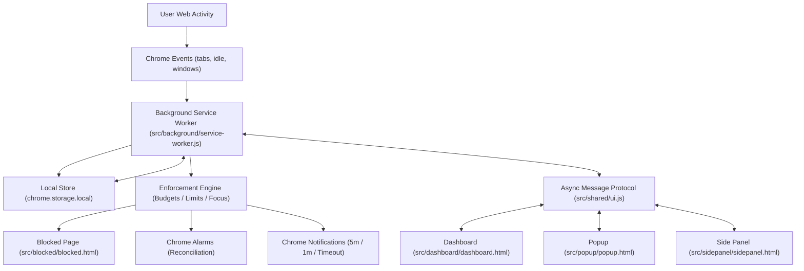
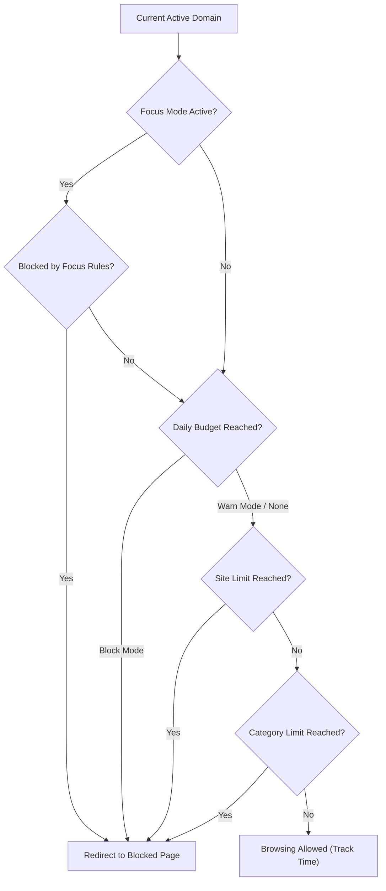

# TimeLens Architecture & Technical Specifications

**Version:** 1.7.0+  
**Platform:** Chrome Extension (Manifest V3)  
**Execution Environment:** Zero-remote execution, 100% private local storage (`chrome.storage.local`).

---

## 1. High-Level Architecture Overview

TimeLens operates strictly on local browser events without any remote analytics, external APIs, tracking pixels, or cloud sync servers.

---

## 2. Attention Tracking Model

Unlike conventional browser extensions that measure how long a tab is merely open in the background, TimeLens measures **Active Attention Time**.

A website domain accumulates active time if and only if **all three** of the following conditions hold simultaneously:
1. **Active Tab:** The tab is the currently active tab in its window (`chrome.tabs.onActivated`).
2. **Focused Window:** The Chrome browser window is focused and in the foreground (`chrome.windows.onFocusChanged`).
3. **Active User:** Chrome reports the user state as `active` (not `idle` or `locked` via `chrome.idle.onStateChanged`).

### Active Domain Resolution

URLs are normalized strictly into lower-case clean hostnames with collapsible prefixes removed (`www.`, `m.`, `mobile.`, `old.`, `new.`):
- `https://www.youtube.com/watch?v=123` $\rightarrow$ `youtube.com`
- `https://music.youtube.com/` $\rightarrow$ `music.youtube.com`
- Internal pages (`chrome://`, `about:`, `file://`) are ignored.

---

## 3. Boundary Enforcement Engine

### 1. Daily Browsing Budget
- Single overarching daily threshold across all web usage.
- Supports `warn` (non-blocking notification) or `block` mode.

### 2. Site Limits
- Configured per normalized domain.
- Periods: `daily` (resets midnight), `weekly` (resets Monday 00:00), `monthly` (resets 1st of month).
- Optional Smart Schedules: Restricts limits to designated weekdays and time windows.
- Strict Mode: Disallows temporary 5-minute extensions.

### 3. Category Limits
- Groups multiple domains under a single shared quota (e.g. `Social`, `Entertainment`).
- Evaluated via `createDomainMatcher` hash Set and suffix tree resolution.

### 4. Focus Mode
- Pomodoro/time-boxed sprint engine (25/45/60/90m or custom).
- Modes: `block` (block designated distracting sites) or `allow` (block all sites except designated tools).
- Quick extension support (`EXTEND_FOCUS`) for on-the-fly flow state preservation.

---

## 4. Message Protocol & Resilience

Every message passed between UI surfaces and the service worker follows an asynchronous request/response pattern wrapped with timeout and retry capabilities (`src/shared/ui.js`):

- **Timeout:** 10,000ms deadline to avoid hung promises when service worker sleeps.
- **Retry:** Automatically retries transient connection errors once upon worker wake-up.
- **Envelope:** Standardized `{ ok: boolean, data?: any, error?: string }` payload.

| Message Type | Direction | Payload | Description |
| --- | --- | --- | --- |
| `GET_SNAPSHOT` | UI $\rightarrow$ SW | `{ rangeDays: number }` | Fetches active limits, usage stats, and diagnostics. |
| `SAVE_LIMIT` | UI $\rightarrow$ SW | `{ limit: LimitObject }` | Upserts site limit. |
| `DELETE_LIMIT` | UI $\rightarrow$ SW | `{ domain: string }` | Deletes site limit. |
| `START_FOCUS` | UI $\rightarrow$ SW | `{ minutes, domains, mode, name }` | Initiates Focus session. |
| `EXTEND_FOCUS` | UI $\rightarrow$ SW | `{ minutes: number }` | Adds minutes to ongoing Focus session. |
| `STOP_FOCUS` | UI $\rightarrow$ SW | none | Terminates Focus session. |
| `ADD_ALLOWANCE`| UI $\rightarrow$ SW | `{ domain, minutes }` | Grants temporary 5m extension for non-strict limits. |

---

## 5. Security & Privacy Guarantees

1. **No External Network Calls:** Validated in CI (`scripts/validate-extension.mjs`); no `fetch()`, `XMLHttpRequest`, or remote script tags.
2. **Minimal Permissions:** Uses only `tabs`, `storage`, `idle`, `alarms`, `notifications`, and `sidePanel`. No broad host permissions (`<all_urls>`).
3. **Safe Redirections:** Blocked URLs are stored in `chrome.storage.session` and never leaked into browser query strings.
4. **Deterministic Audits:** Previews pass automated WCAG 2.2 AA axe accessibility tests and headless Chrome visual regression suites.
